<p align="center">
  
</p>
# C++ AI Agent CLI

This repository contains a custom-built, autonomous AI coding assistant written entirely in C++. Inspired by advanced CLI agents, it uses Large Language Models (LLMs) to understand code, execute terminal commands, and perform actions through a robust tool-calling architecture.

The project implements a complete agentic loop, HTTP RESTful API integration for LLM communication, OpenAI-compatible tool calling, and a recursive subagent skills framework.

## Key Architecture & Features

* **Native Tool Calling:** The agent autonomously executes local system tasks using built-in `Read`, `Write`, and `Bash` execution tools, allowing it to modify code and run terminal commands directly.
* **Dynamic Skill Discovery:** Automatically scans the `.claude/skills/` directory for custom agent skills. It parses YAML-style frontmatter to dynamically register tool descriptions and capabilities to the LLM's system prompt at runtime.
* **Argument Substitution:** Supports stacking multiple skills in a single prompt (e.g., `/lint /test src/main.cpp`) with automatic `$ARGUMENTS` injection into the skill templates.
* **Recursive Subagents (`context: fork`):** Complex skills run in completely isolated conversational contexts. The main agent spawns a secondary event loop for the subagent, returning only the final execution result back to the main conversation. This strictly preserves token context limits and prevents context-bleeding/hallucinations.
* **Bundled Script Execution:** Skills can bundle their own relative shell scripts and execute them securely without hardcoding absolute system paths.

## Tech Stack

* **Language:** C++17 / C++20
* **Networking:** `cpr` (C++ Requests) for HTTP RESTful API communication
* **Data Handling:** `nlohmann/json` for robust JSON serialization and deserialization
* **LLM Provider:** OpenRouter API (Supports Anthropic Claude 3.5 Sonnet, Haiku, etc.)

## Getting Started

The main entry point for the agent implementation is located in `src/main.cpp`.

### 1. Prerequisites
Ensure you have `cmake` and a compatible C++ compiler installed on your local machine. The project relies on `vcpkg` for dependency management (`cpr` and `nlohmann-json`).

### 2. Environment Variables
You must set your OpenRouter credentials before running the agent:
```sh
export OPENROUTER_API_KEY="your_api_key_herexyz"
export OPENROUTER_BASE_URL="[https://openrouter.ai/api/v1](https://openrouter.ai/api/v1-dont use )"
